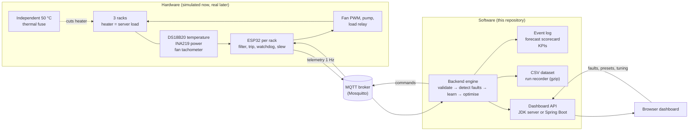
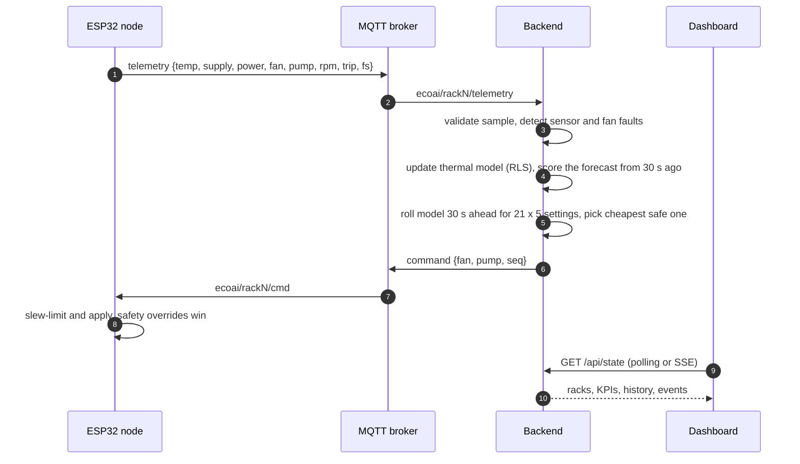
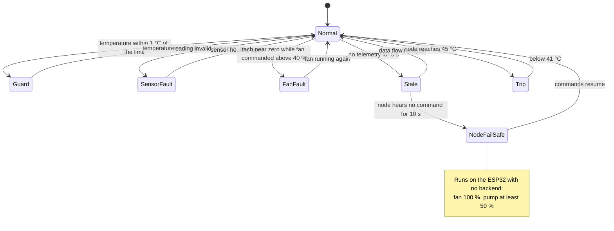
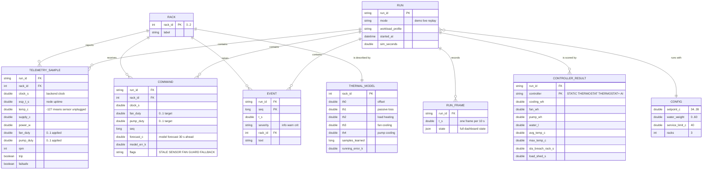

<div align="center">

# EcoAI Grid

**AI-powered cooling optimisation for data centres**

A predictive controller that learns each rack's thermal behaviour online and picks the cheapest fan and pump setting that keeps the rack safe. Includes a hardware simulator, MQTT integration, a Spring Boot API and a live dashboard.

Java 17 · Spring Boot 3.3 · MQTT 3.1.1 · ESP32 · zero-dependency demo build


">

</div>

---

## Contents

1. [Overview](#1-overview)
2. [Key results](#2-key-results)
3. [Features](#3-features)
4. [System architecture](#4-system-architecture)
5. [How the controller works](#5-how-the-controller-works)
6. [Safety design](#6-safety-design)
7. [Data model (ER diagram)](#7-data-model-er-diagram)
8. [Quick start](#8-quick-start)
9. [Configuration](#9-configuration)
10. [API reference](#10-api-reference)
11. [MQTT contract](#11-mqtt-contract)
12. [Results in detail](#12-results-in-detail)
13. [Testing and verification](#13-testing-and-verification)
14. [Project structure](#14-project-structure)
15. [Moving to real hardware](#15-moving-to-real-hardware)
16. [Limitations](#16-limitations)
17. [Roadmap](#17-roadmap)
18. [Troubleshooting](#18-troubleshooting)
19. [Team and credits](#19-team-and-credits)

---

## 1. Overview

### The problem
Cooling is one of the largest energy costs in a data centre and a growing water issue. Common controllers are either fixed-speed
(always running hard) or reactive thermostats (acting only after a rack is already hot). Both waste energy, and neither copes
well with faults such as a dead fan or a bad sensor.

### The approach
EcoAI Grid treats cooling as a prediction problem:

1. Each rack's temperature is modelled as `dT/dt = leakage + heat input - fan cooling - pump cooling`.
2. The model's coefficients are **learned online** from telemetry (recursive least squares), so it adapts to the rack it is controlling.
3. Every second the optimiser rolls the model 30 s ahead for 21 fan x 5 pump settings and picks the **cheapest setting that stays under the target**, with a margin taken from the model's own error.
4. Independent safety layers sit underneath the AI, so safety never depends on the AI or the network.

### What is in the repository

| part | description |
|---|---|
| Control engine | validation, fault detection, online thermal model, predictive optimiser, event log, forecast scorecard |
| Hardware simulator | three racks with heaters, sensors, fans, pump, ESP32 behaviour and an injectable fault set; speaks the same MQTT messages as the real nodes |
| MQTT integration | a small MQTT 3.1.1 client, `backend` and `simulator` modes over a real broker |
| Dashboard | single-page web UI: live rack drawings, controller comparison, charts, alerts, fault console, reports, replay |
| REST and Spring Boot | documented API, validation, server-sent events, health checks (plus a zero-dependency JDK server for the demo) |
| ESP32 firmware | sketch that implements the wire contract (`firmware/esp32_node`) |

> The hardware rig is being built separately. Until it exists, all readings come from the simulator, and the software path
> to real hardware is already exercised over MQTT.

---

## 2. Key results

Simulation, 4 simulated hours, 3 racks, identical workload and the same fault schedule for every controller.
Service limit 40 °C, AI target 38 °C. Full tables in [section 12](#12-results-in-detail).

| | result |
|---|---|
| Limit breaches (AI) | **0** in all 6 seeds and in all 6 workload presets |
| Cooling energy vs. fixed speed | **-77 to -79 %** |
| Cooling energy vs. thermostat (mixed load) | **-10 to -14 %** |
| Raised thermostat (same temperature) | breached the limit in 5 of 6 seeds; AI used 22 to 27 % more energy than it, without breaching |
| 30 s forecast error | about **0.2 K** typical; **0.35 to 0.57 K** while temperature is moving, against 1.1 to 1.4 K for "it stays the same" |

These figures come from a simulator whose physics resembles the controller's model, so they are optimistic until the real rig
is logged. Under heavy load the AI can use more energy than a plain thermostat, which in those runs went over the limit.
Details and caveats are in [section 12](#12-results-in-detail) and [section 16](#16-limitations).

---

## 3. Features

| area | capability |
|---|---|
| **Control** | online-learned thermal model per rack, 30 s look-ahead optimiser, uncertainty margin, thermostat fallback |
| **Safety** | backend guard, ESP32 over-temperature trip, independent 50 °C thermal fuse, watchdog fail-safe, full cooling on sensor fault, fan-fault detection from the tachometer |
| **Explainability** | each rack card states why the controller chose its setting, in one plain sentence |
| **Forecast scorecard** | every 30 s forecast is stored and scored against what actually happened, next to a "stays the same" guess |
| **Alerts** | timestamped event log with severity: fan fault, sensor fault, no data, node fail-safe, trip, limit breach |
| **Workload presets** | Mixed, Idle, Office day, Batch jobs, Spiky, Stress; switch live |
| **Fault console** | fan failure, frozen or unplugged sensor, load bursts, network drop; each reflects the simulated state |
| **Comparison** | fixed speed, thermostat, raised thermostat and AI on identical load and faults, side by side |
| **Reports** | printable HTML report (save as PDF) and CSV for the current run; evaluation report across seeds and presets |
| **Record and replay** | save any run and play it back with a scrub bar and run picker |
| **Access token** | optional shared secret for LAN use |
| **Hardware path** | MQTT client, simulator and backend as separate processes, ESP32 firmware sketch |
| **Dashboard** | light and dark themes, live thermal drawings, hover charts with forecast overlay, offline fonts, mobile layout |

<div align="center">

</div>

---

## 4. System architecture



The engine is one set of classes behind a small interface (`state`, `control`, `events`, `report`, `runs`, `health`).
Three front ends use it: the zero-dependency JDK server, the Spring Boot controllers and the replay player.

### Control loop, one rack, one second



### Operating modes of one rack



---

## 5. How the controller works

**Model.** For each rack the temperature change per second is

```
dT/dt = th0 + th1·(T - supply)/10 + th2·P/50 + th3·fan·(T - supply)/10 + th4·pump·(T - supply)/10
```

where `P` is the measured IT power. `th1` is passive loss, `th2` is heating from load, `th3` and `th4` are fan and pump cooling.
The five coefficients are estimated by recursive least squares over a 10 s window and start from a deliberately wrong datasheet guess.

**Optimiser.** Each second, for every one of 21 fan duties x 5 pump duties, the model is rolled forward 30 s assuming the
current load plus a little headroom. The cheapest setting whose predicted temperature stays under the target ceiling (minus
an uncertainty margin from the model's running error) is chosen. Cost is fan power plus pump power plus a water-priority term.

**Guards and fallbacks.**

| situation | behaviour |
|---|---|
| model not trusted yet (coefficients implausible) | thermostat rules, event logged |
| temperature within 1 °C of the limit | maximum cooling |
| temperature sensor unplugged, invalid or frozen | full cooling, no decisions on bad data |
| fan dead (tach near zero while commanded) | stop relying on the fan, use the pump, periodically test recovery |
| no telemetry for 5 s | rack marked stale, last command held, node watchdog takes over at 10 s |

**Tunables (live):** target ceiling 34 to 39 °C (default 38) and water priority 0 to 60 (default 15).
A higher ceiling saves fan energy and leaves less headroom; a higher water priority spends more electricity to keep coolant use down.

---

## 6. Safety design

The AI is an optimiser on top of protections that do not depend on it.

| layer | trigger | action | needs network |
|---|---|---|---|
| Thermal fuse (hardware) | 50 °C | cuts the heater | no |
| ESP32 trip | 45 °C (reset below 41 °C) | opens load relay, fan and pump 100 % | no |
| ESP32 watchdog | no command for 10 s | fan 100 %, pump at least 50 % | no |
| ESP32 sensor check | reading of -127 (unplugged) | fan and pump 100 % | no |
| Backend guard | within 1 °C of the limit | maximum cooling | yes |
| Backend fault logic | stuck or invalid sensor, dead fan | full cooling, stop commanding the dead fan | yes |
| AI optimiser | normal operation | cheapest safe duty over 30 s | yes |

---

## 7. Data model (ER diagram)

The system currently stores data as CSV (telemetry dataset) and gzip-compressed JSON lines (recorded runs); there is no
relational database. The diagram below is the **logical data model** of what the system produces and exchanges, and it is the
schema to use when a database (PostgreSQL or InfluxDB) is added.



| entity | where it lives today |
|---|---|
| `TELEMETRY_SAMPLE` + `COMMAND` | one CSV row per sample: `--log data/run.csv` (columns `clock_s, esp_t, rack, temp_c, supply_c, power_w, fan, pump, rpm, cmd_fan, cmd_pump, pred_c, model_err_k, flags`) |
| `EVENT` | in-memory ring of 500 events, included in the dashboard state and the report |
| `RUN_FRAME` | `runs/run-<timestamp>-<mode>.jsonl.gz`, one frame every 10 simulated seconds (`--record runs`) |
| `CONTROLLER_RESULT` | computed at report time from the rig meters, shown in the scoreboard and exported as CSV |
| `THERMAL_MODEL`, `CONFIG` | in memory (the model is relearned from telemetry within minutes) |

---

## 8. Quick start

### Prerequisites
- JDK 17 or newer (`java -version`)
- For the Spring Boot build only: Maven 3.9+ and internet access on first build

### A. Plain JDK build (no downloads, used for the demo)

```bash
./build.sh                       # Windows: build.bat   -> creates ecoai-grid.jar
java -jar ecoai-grid.jar         # dashboard at http://localhost:8080
java -jar ecoai-grid.jar selftest
```

Let the demo run about 30 seconds at the default speed so the model has learned and the charts have history.

### B. Spring Boot build

```bash
mvn spring-boot:run              # http://localhost:8080, settings in src/main/resources/application.yml
mvn test
mvn spring-boot:run -Dspring-boot.run.arguments="--ecoai.mode=live --ecoai.mqtt-host=localhost"
```

### Run modes (plain JDK build)

| command | purpose |
|---|---|
| `java -jar ecoai-grid.jar demo` | simulator, four controllers and dashboard in one process (default) |
| `... demo --record runs` | same, and save the run for replay |
| `... replay runs` | play back the newest saved run (or pass a file) |
| `... report --seeds 6 --hours 4 --out report.html` | evaluation report over seeds and workload presets (about 5 minutes) |
| `... headless --hours 4 --faults` | batch run, prints the comparison table |
| `... selftest` | 15 regression checks, exit code 0 means pass |
| `... simulator` | hardware stand-in publishing to an MQTT broker |
| `... backend --mqtt localhost:1883 --log data/run.csv --record runs` | AI backend and dashboard on a broker |

### Command-line flags

| flag | default | meaning |
|---|---|---|
| `--port` | 8080 | dashboard port |
| `--speed` | 20 | simulated seconds per real second (demo) |
| `--seed` | 42 | random seed |
| `--hours` | 4 | length of headless and report runs |
| `--faults` | off | inject the standard fault schedule (headless) |
| `--setpoint` | 38 | AI target ceiling, °C |
| `--water-weight` | 15 | water priority |
| `--mqtt` | localhost:1883 | broker for `backend` and `simulator` |
| `--log file.csv` | off | write the telemetry and decision dataset |
| `--record dir` | off | save the run for replay |
| `--token secret` | off | require the token on every request |
| `--lan` | off | listen on all interfaces (use with `--token`) |

---

## 9. Configuration

Spring Boot settings (`src/main/resources/application.yml`, overridable with `--ecoai.<name>=...` or `ECOAI_<NAME>` variables):

| property | default | meaning |
|---|---|---|
| `server.port` | 8080 | HTTP port |
| `server.address` | 127.0.0.1 | bind address; use `0.0.0.0` with a token for LAN access |
| `ecoai.mode` | demo | `demo` (simulated rig) or `live` (MQTT backend) |
| `ecoai.seed` | 42 | demo random seed |
| `ecoai.speed` | 20 | demo speed |
| `ecoai.record-dir` | runs | directory for recorded runs, empty to disable |
| `ecoai.csv-log` | empty | telemetry dataset file, empty to disable |
| `ecoai.token` | empty | shared secret for all requests when set |
| `ecoai.mqtt-host` / `ecoai.mqtt-port` | localhost / 1883 | broker for live mode |

---

## 10. API reference

The Spring Boot build serves the documented, validated `/api/v1` routes; the bundled dashboard uses the unversioned routes,
which both builds provide. Full specification: [`docs/openapi.yaml`](docs/openapi.yaml).

| method and path | description |
|---|---|
| `GET /api/v1/state` | full dashboard state: controllers, racks, KPIs, history, recent events |
| `GET /api/v1/stream` | server-sent events, one `state` event per second |
| `GET /api/v1/events` | safety and fault events, newest first |
| `GET /api/v1/config` | current optimiser settings |
| `PUT /api/v1/config` | tune the optimiser: `setpoint` 34 to 39, `waterWeight` 0 to 60 (400 with field errors outside the range) |
| `POST /api/v1/commands` | inject a fault or change workload: `{"cmd":"fanfail","rack":1}`, `{"cmd":"profile","name":"batch"}` |
| `GET /api/report.html` | printable report of the current run |
| `GET /api/report.csv` | results table of the current run |
| `GET /api/runs` | saved runs |
| `GET /actuator/health` | health, including the control engine and the broker link in live mode |

```bash
curl -s localhost:8080/api/v1/config
curl -s -X PUT  localhost:8080/api/v1/config   -H 'Content-Type: application/json' -d '{"setpoint":37.5}'
curl -s -X POST localhost:8080/api/v1/commands -H 'Content-Type: application/json' -d '{"cmd":"fanfail","rack":1}'
curl -N localhost:8080/api/v1/stream
```

With a token set, send it as `?token=`, an `X-Token` header, or rely on the cookie set after opening `/?token=...` once.

---

## 11. MQTT contract

Broker: any MQTT 3.1.1 broker (Mosquitto recommended), QoS 0, anonymous on a private LAN. Full detail:
[`docs/MQTT_CONTRACT.md`](docs/MQTT_CONTRACT.md).

| direction | topic | rate | payload |
|---|---|---|---|
| node → backend | `ecoai/rack<N>/telemetry` | 1 Hz | `{"rack":0,"t":123,"temp":34.5,"supply":24.1,"power":28.4,"fan":0.55,"pump":0.0,"rpm":1650,"trip":0,"fs":0}` |
| backend → node | `ecoai/rack<N>/cmd` | per sample | `{"fan":0.55,"pump":0.25,"seq":42}` |
| dashboard → simulator | `ecoai/sim/control` | on demand | `{"cmd":"fanfail","rack":1}` |

`temp = -127` means the DS18B20 sensor is unplugged. Real hardware does not subscribe to the simulator control topic.

---

## 12. Results in detail

**Setup.** 4 simulated hours, 3 racks, identical workload and fault schedule for all controllers. Faults: synchronised load
spike, a dead fan, a frozen sensor, an unplugged sensor, a 90 s network outage. "Raised thermostat" is the fair challenger: the
same reactive thermostat shifted up to run at the AI's temperature. Everything here is regenerated by
`java -jar ecoai-grid.jar report`; the complete tables are in [`docs/evaluation-report.html`](docs/evaluation-report.html).

### Mixed workload, six seeds (target 38 °C, water priority 15)

| AI cooling energy vs. | range over seeds | mean |
|---|---|---|
| fixed speed | -77 to -79 % | -78 % |
| thermostat | -10 to -14 % | -12 % |
| raised thermostat | +22 to +27 % | +24 % |

The AI recorded zero time above 40 °C in all six runs; the raised thermostat breached the limit in five (37 to 210 rack-seconds).
At a 39 °C target the AI uses 26 to 31 % less energy than the thermostat and about the same as the raised thermostat, again without breaches.

### Workload presets (seed 1, same faults)

| preset | AI energy vs. thermostat | seconds over the limit: fixed / thermostat / raised / **AI** |
|---|---|---|
| Mixed | -10 % | 0 / 0 / 0 / **0** |
| Idle | +20 % (2.6 vs 2.2 Wh) | 0 / 0 / 0 / **0** |
| Office day | -11 % | 0 / 19 / 211 / **0** |
| Batch jobs | +15 % | 0 / 238 / 309 / **0** |
| Spiky | +1 % | 0 / 0 / 286 / **0** |
| Stress | +12 % | 142 / 60 / 699 / **0** |

### Forecast accuracy (mixed workload, six seeds)

| measure | value |
|---|---|
| typical 30 s forecast error | 0.21 to 0.23 K |
| deliberate bias (plans for slightly more load) | about +0.2 K |
| error while the temperature is moving | 0.35 to 0.57 K |
| "it stays the same" guess while moving | 1.1 to 1.4 K |

While the controller holds a steady temperature the "stays the same" guess is already very accurate, so the scorecard is split.

### How to read the results
- The saving against a conventional thermostat appears at moderate load and comes mostly from **running the racks warmer**. A thermostat raised to the same temperature uses less energy still. What the AI adds is **staying under the limit**: it was the only controller with zero breaches in every preset.
- Under heavy or bursty load the AI can use **more** energy than the plain thermostat; in those runs the thermostat went over the limit, so the comparison is not like for like. The Idle difference is tiny in absolute terms.
- Water is a trade-off, not a saving. The liquid loop is cheap in electricity, so the optimiser favours it; the water-priority setting moves along that trade-off.
- Energy figures describe this small rig (about 10 Wh of cooling per 311 Wh of IT load over 4 h). They say nothing yet about a full-size data centre.
- Live numbers in the demo move with whatever is injected. Right after a fan failure the AI can show more energy than the thermostat while it protects the rack. The tables above are 4-hour averages.

---

## 13. Testing and verification

| check | how to run | what it covers |
|---|---|---|
| Self-test (15 checks) | `java -jar ecoai-grid.jar selftest` | no limit breach, peak temperature, fuse never needed, energy vs. baselines, model accuracy, estimator vs. meter (energy and water), event log, forecast vs. "stays the same", every workload preset, report export, record and replay, token enforcement |
| Spring Boot tests (10) | `mvn test` | 9 MockMvc API contracts (dashboard, state, config bounds, command validation, reports, health) plus the core regression check |
| Browser checks | manual or Playwright | light and dark themes, mobile width without horizontal scroll, presets, fault console, alerts, replay controls |

**Verified.** `mvn -q clean package` and `mvn test` pass against Spring Boot 3.3.5. Demo mode was run over HTTP: dashboard and
bundled fonts, dashboard controls, reports, v1 validation, SSE, actuator health, and token and cookie access.

**Not verified.** Live MQTT mode under Spring (no Mosquitto available during testing), the firmware on a real ESP32, and anything on physical hardware.

---

## 14. Project structure

```
ecoai-grid/
├── pom.xml                         Spring Boot build
├── build.sh / build.bat            plain-JDK build (excludes ecoai/boot, no downloads)
├── firmware/esp32_node/            ESP32 sketch implementing the MQTT contract
├── docs/
│   ├── MQTT_CONTRACT.md            wire format and protection layers
│   ├── openapi.yaml                REST API specification
│   ├── DEMO_SCRIPT.md              five-minute demo flow and likely questions
│   ├── evaluation-report.html      multi-seed and per-preset results
│   └── images/                     screenshots
└── src/
    ├── main/java/ecoai/
    │   ├── Main.java, Config.java  entry point, tunables, topic names
    │   ├── bus/                    MessageBus, in-memory broker, MQTT 3.1.1 client
    │   ├── model/                  Telemetry and Command (the wire contract)
    │   ├── sim/                    rack physics, ESP32 model, workload presets, fault injection
    │   ├── control/                Backend, RLS thermal model, policies, event log
    │   ├── app/                    DemoApp, LiveEngine, ReplayApp, reports, recorder, self-test
    │   ├── web/                    zero-dependency dashboard server and state builder
    │   └── boot/                   Spring Boot controllers, validation, SSE, token filter, health
    ├── main/resources/             dashboard page, bundled fonts, application.yml
    └── test/java/ecoai/boot/       API contract tests and core regression test
```

---

## 15. Moving to real hardware

1. Install Mosquitto on the laptop. In `mosquitto.conf`: `listener 1883 0.0.0.0` and `allow_anonymous true` (private LAN only).
2. Flash `firmware/esp32_node/esp32_node.ino` with `RACK_ID`, the WiFi credentials and the laptop's IP (one board per rack).
3. Run `java -jar ecoai-grid.jar backend --mqtt localhost:1883 --log data/run.csv --record runs`. Do not start the simulator.
4. Compare the logged real data with the simulator's behaviour (same metrics as section 12) and adjust the model priors if needed.

To rehearse the same path with no hardware, run `mosquitto`, then `simulator` and `backend` in two more terminals.

---

## 16. Limitations

- **The simulator's physics has the same structure as the learned model**, so the 0.2 K accuracy is optimistic. Real racks add thermal lag, non-linear fan curves and sensor-placement effects. Validation on the real rig is the next milestone; `--log` and `--record` capture what is needed.
- Nothing has run on hardware yet. The firmware is written to the contract but not compiled on a board, and the INA219 shunt range must be checked against the heater current.
- Live MQTT mode under Spring Boot still needs a Mosquitto-backed verification. The MQTT client was tested against the amqtt broker, not Mosquitto, and not with a real ESP32.
- Not implemented: database storage (CSV and compressed run files are written instead), ONNX model serving (the model is learned online in Java), React front end.
- "Sensor stuck" detection is tuned to simulated noise; a very stable real sensor could trip it. That fails safe (full cooling).
- Energy and water on the dashboard are estimated from fan and pump duty with calibrated power laws, within 1 to 6 % of the simulator's meter, and they cannot see a network outage.
- The access token is a shared secret over plain HTTP: fine on a private LAN for a demo, not for the internet.
- Results describe this scale model and these fault schedules only. They are not claims about full-size data centres.

---

## 17. Roadmap

| stage | item |
|---|---|
| Hardware | build the three-rack rig, flash the ESP32 nodes, run the MQTT path end to end |
| Validation | log real telemetry, compare against the simulator, retune model priors and uncertainty margin |
| Storage | PostgreSQL or InfluxDB behind the existing run and telemetry interfaces, using the data model in section 7 |
| Machine learning | offline training in Python on logged data, served through ONNX Runtime behind the `Policy` interface, compared with the online model |
| Interface | React front end using the existing REST and SSE API |
| Operations | Prometheus metrics, authentication beyond a shared token |

---

## 18. Troubleshooting

| symptom | fix |
|---|---|
| dashboard is blank | the process stopped; run it again. Check that `ecoai-grid.jar` was built |
| port already in use | `--port 8081` (plain build) or `--server.port=8081` (Spring Boot) |
| `unknown option` on the command line | flags go after the mode, for example `java -jar ecoai-grid.jar demo --port 8081` |
| 401 in the browser | a token is set; open `/?token=<token>` once |
| other devices cannot connect | start with `--lan --token <secret>` (Spring Boot: `server.address=0.0.0.0`) and allow the port in the firewall |
| `mvn` cannot download dependencies | needs internet on first build; the plain JDK build needs none |
| live mode shows "Broker disconnected" | start Mosquitto and check host and port |

---

## 19. Team and credits

**EcoAI Grid** is a two-semester major project at The NorthCap University (B.Tech CSE).

| role | person |
|---|---|
| Software, control engine, backend and dashboard | Akash Tomar |
| Hardware and firmware | Arpit |
| Mentor | Mr. Sumit Kumar |

Dashboard fonts: Bricolage Grotesque and Hanken Grotesk, bundled under the SIL Open Font License (`src/main/resources/web/fonts/LICENSES.txt`).
